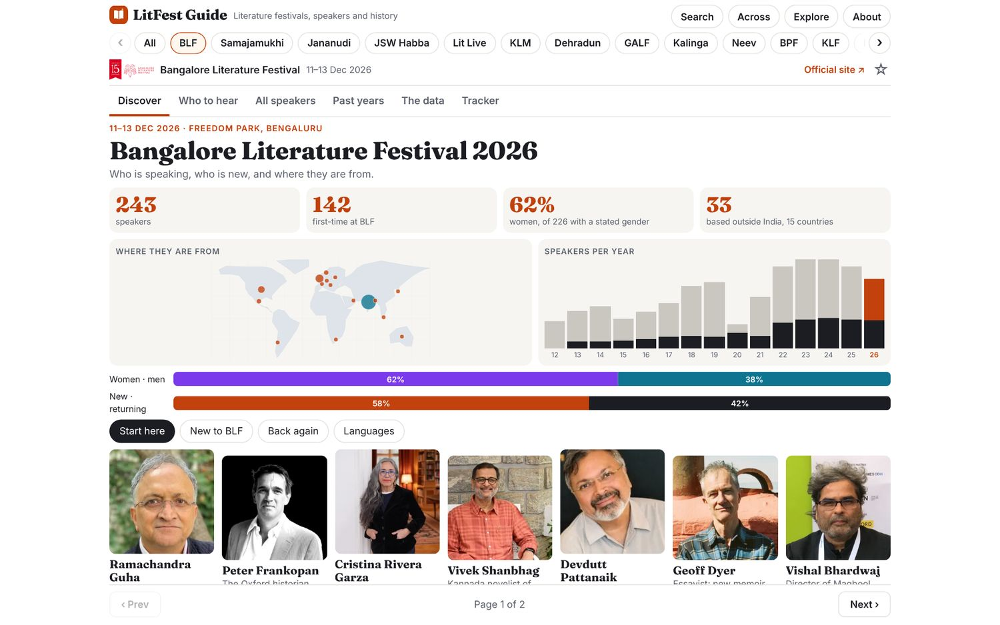
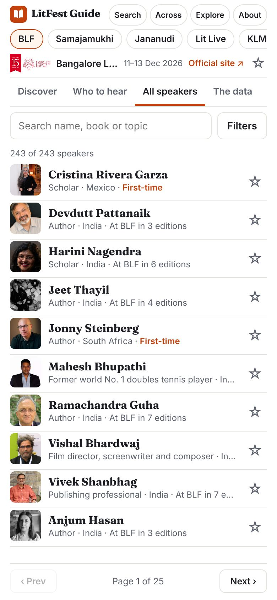

# LitFest Guide

**One free guide to who speaks at literature festivals, starting with India: who is new, who keeps coming back, and what to read before you go.**

Open it here: **https://omshivaprakash.github.io/litfest-speaker-guide/**
Works on any phone or laptop. No account, no ads, no app store. You can install it like an app, and it keeps working without internet after your first visit.

  
  

---

## Why this exists (the short, honest version)

If you love books, a literature festival is a gift. But planning for one is oddly hard.

- Every festival puts its speakers on **its own website**, in **its own format**.
- Last year's list quietly disappears when the new one goes up.
- You cannot easily answer simple questions like:
  - *"Who is coming this year that I have never seen before?"*
  - *"Is my favourite author doing the festival circuit, and where?"*
  - *"What did this festival look like five years ago?"*
  - *"Which books should I read before I go?"*
- And if you go to more than one festival, you end up with a dozen browser tabs open.

**LitFest Guide puts all of it side by side**, in one clean place, built for a thumb on a phone.

It was built by a reader, for readers. It is free, it will stay free, and it is not run by any festival.

---

## What you can do with it

| You want to… | Where to go |
|---|---|
| Find festivals by **region**: India, a particular state, or international | **Home page** filters |
| See a festival at a glance: how many speakers, how many are new, how many women, where they come from | Open any festival, **Discover** tab |
| Find who to hear first | **Who to hear** tab |
| Browse everyone, search by name, book or topic, filter by country or language | **All speakers** tab |
| See what happened **last year** (or any year): who spoke, who was new, who came back | **Past years** tab |
| Understand the numbers: new vs returning, gender, countries, books | **The data** tab |
| Keep a shortlist of people you want to see | Tap the **☆** on any speaker, then open **Tracker** or **Explore → Bookmarks** |
| Look up one person across **every festival and year** | **Search** (top bar) |
| See what the **press** wrote about a festival and when | **Explore → Press** |
| See who is a **journalist, filmmaker, politician, scholar…**, not only authors | The colour-coded profession tags, the **Other professions** shelf and the **Profession** filter |
| Find the **children's** sessions and the people who write for young readers | **Explore → Kids**, or the **Children's** tag and filter inside a festival |
| See whether winning a prize led to a festival invitation | **Explore → Prizes → Prize effect** |
| See which festivals share the same speakers | **Across** (top bar) |
| Browse a bookshelf made of the speakers' books, see prize winners, debut decades, translators | **Explore** (top bar) |
| Know when the next festival starts, add it to your calendar, get a reminder | **Explore → Upcoming** |
| Use it in Kannada or Hindi | **About → Language** (beta) |

Detailed steps are in the **[User guide](docs/USER-GUIDE.md)**.

---

## Festivals covered

**Live now (23):** Bangalore Literature Festival · Jaipur Literature Festival · Hyderabad Literary Festival · Kerala Literature Festival · Mathrubhumi International Festival of Letters · Literature Live! The Mumbai LitFest · Kolkata Literary Meet · Kalinga Literary Festival · Goa Arts and Literature Festival · Bhopal Literature & Art Festival · Dehradun Literature Festival · Neev Literature Festival · Bengaluru Poetry Festival · Wayanad Literature Festival · Koshala Literature Festival (Lucknow) · Mysuru Literature Festival · Ahmedabad International Literature Festival · Shillong Literary Festival · Book Brahma Literature Festival · JSW Sahitya Habba · Samajamukhi Sahitya Sammelana · Jananudi · Hay Festival Winter Weekend

**Listed, with dates from the official site and speakers to come:** CLF Literati, Chandigarh (4 to 6 Dec 2026) · Nalanda Literature Festival, Bihar (main festival Oct 2027) · Khushwant Singh Literary Festival, Kasauli (held 23 to 25 Oct 2026)

**Work in progress (organisers, please get in touch):** Lit for Life (Chennai) · Apeejay Kolkata Literary Festival · M.S. Randhawa Literature and Art Festival (Chandigarh) · Pune International Literary Festival · Times LitFest (Delhi). We know these exist but have no readable official portal with dates or speakers yet. Dates always come from a festival's own official site.

**Beyond India:** Hay Festival Winter Weekend (Hay-on-Wye, Wales) is live now, and three more are listed with dates, with speakers to come when they publish: Galle Literary Festival (Sri Lanka), Edinburgh International Book Festival (Scotland) and Hay Festival (Hay-on-Wye, Wales). The guide started with India and is growing outward; suggestions for more are welcome.

**By the numbers:** about 9,500 people and 16,000 festival appearances going back as far as 2012, around 1,900 speaker profiles with photos for the current editions, and about 7,700 more profiles of people who spoke in earlier years.

How complete each festival is differs. Some have ten years of history, some only one. The exact picture for each festival is in **[docs/DATA-NOTES.md](docs/DATA-NOTES.md)**.

---

## Can I trust it?

Honestly: mostly, with care. Please read this part.

- **Names, photos, bios and dates** come straight from each festival's own public pages. The festival's website is always the final word. Check it before you travel.
- **Some things are guessed by a computer** from the text of a bio. These are: gender (only from words like *she/her* or *he/his*), country, role, language, and "first time". They can be wrong or blank, and the app says "not stated" rather than pretending to know.
- **"First time"** only means *we did not find this name in the earlier lists we have*. If we only have two years of history, "first time" is a weaker claim than if we have ten.
- **Books** are matched by author name on Open Library, so very occasionally a book belongs to a different person with the same name.
- **Prizes, debut years and translators** are read from bios and Open Library. Treat them as helpful leads, not facts.

Everything the app guesses is labelled, and the full rules are in the **[FAQ](docs/FAQ.md)**.

**Is it affiliated with any festival?** No. It is an independent project for **education and research**. Names, photos and logos belong to their owners and are shown only to identify people and festivals. If you are a festival, author or photographer and want something corrected or removed, [open an issue](https://github.com/omshivaprakash/litfest-speaker-guide/issues/new) and say what and where. Requests are taken seriously.

---

## Your privacy

- No sign-up, no tracking, no analytics, no cookies from us.
- Your stars, bookmarks, reminders and language choice stay **inside your own browser** on your own device. We never see them.
- The site makes **no requests to outside services** when a page loads. Fonts, photos and data are all served from this repository.

---

## How it works, in plain words

- It is a **website made of plain files**: one page, some data files, and a lot of photos. There is **no server, no database and no login**, which is why it is free to run and hard to break.
- Each festival has its own folder of data. A set of small scripts (the *tools*) collects each festival's public lists and turns them into those data files.
- **Every day**, an automatic check looks at each festival's website to see if the speaker list changed, and records it. (See *Staying up to date* below.)
- After your first visit, the site saves itself to your device, so it opens even without internet.

The longer version, with a diagram, is in **[docs/HOW-IT-WORKS.md](docs/HOW-IT-WORKS.md)**.

---

## Staying up to date

A script called the *daily check* compares each festival's live speaker page with the last saved copy. It records who was **added or removed**, flags sites that stopped answering, and lists names that are live on a festival's site but not yet in the app. The latest result shows under **About → Daily check**.

After a change, the maintainer refreshes that festival's data (a short command) and publishes. Step by step in **[docs/MAINTAINING.md](docs/MAINTAINING.md)**.

---

## For the curious and the helpful

| I want to… | Read |
|---|---|
| Learn how to use every feature | [User guide](docs/USER-GUIDE.md) |
| Understand how it is built, without jargon | [How it works](docs/HOW-IT-WORKS.md) |
| Know what each data field means | [Data dictionary](docs/DATA-DICTIONARY.md) |
| Add a festival or refresh data | [Maintaining](docs/MAINTAINING.md) |
| See festival-by-festival notes and gaps | [Data notes](docs/DATA-NOTES.md) |
| Ask "why does it say…?" | [FAQ](docs/FAQ.md) |
| Report a mistake, suggest a festival, or help | [Contributing](docs/CONTRIBUTING.md) |
| Read the press note | [press/press-note.html](press/press-note.html) |

**Run it on your own computer:** download the folder, open a terminal in it, run `python3 -m http.server`, and visit `http://localhost:8000`. (Opening `index.html` by double-click will not work, because browsers block loading data files that way.)

**License:** MIT. Free to use, copy and change. See [LICENSE](LICENSE).

**Built by** [omshivaprakash](https://omshivaprakash.github.io/). To reach out, use the GitHub issues on this repository.
